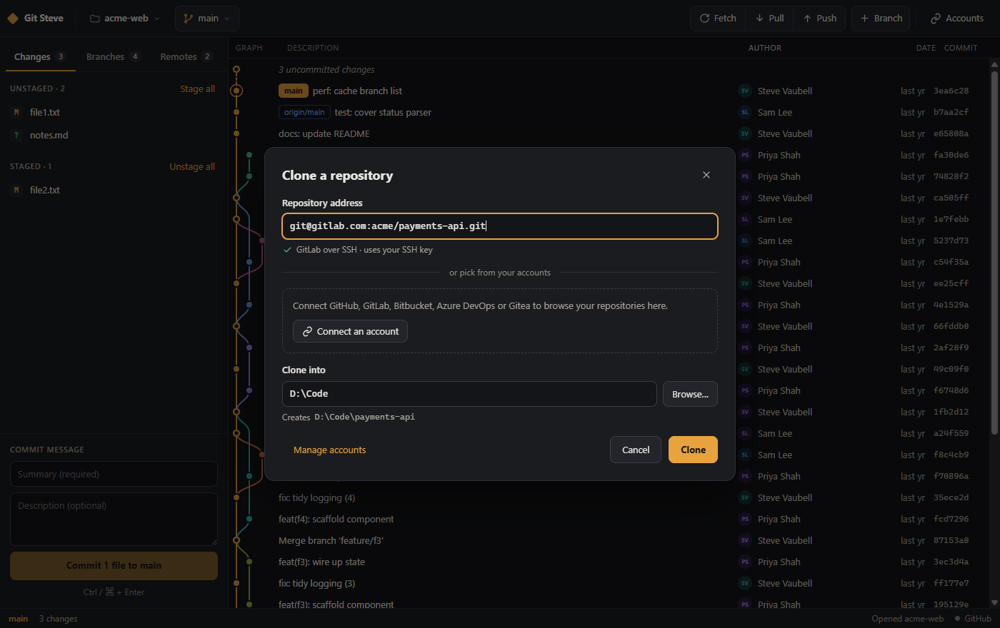
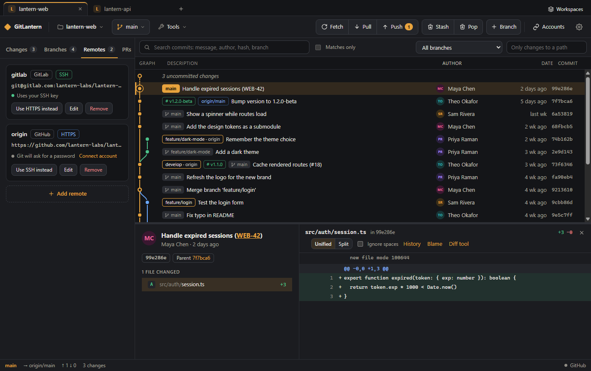

# GitLantern

**A fast, friendly desktop Git client for Windows and macOS.**

GitLantern shows your repository's history as a colour-coded commit graph. You can stage and commit
changes, switch branches, and fetch, pull and push, all from one window. It connects to **any Git
service** (GitHub, GitLab, Bitbucket, Azure DevOps, Gitea/Forgejo or your own server) with a token or an
SSH key. It runs the Git you already have installed, so your existing config, hooks and credential
managers keep working.


> **Status: early preview (v0.1).** Tested on Windows 11. The macOS build is experimental.

---

## Features

### Your history

- **Commit graph:** every branch, merge and tag as a coloured lane graph, with author avatars. It
  shows the latest 2,000 commits across all branches and scrolls smoothly through them. Uncommitted
  work appears as a dashed row on top.
- **Branch on every commit:** each commit is labelled with the branch it belongs to, even after that
  branch was merged and deleted (then the name comes from the merge commit and is shown in italics).
- **Search and filter:** search the history by message, author, hash or branch name, step through the
  matches with **Enter**, or show only the matches. Narrow the graph to one branch, or to the commits
  that changed a file or folder.
- **Commit details and diffs:** click a commit to see its message, author, parents and changed files
  with line counts. The diff alongside has line numbers.
- **Stage and commit:** stage or unstage single files or everything at once, see each file's diff, and
  write a summary plus an optional description.
- **Lines and hunks:** stage, unstage or discard a single hunk with the buttons on it, or pick lines by
  clicking their line numbers (Shift-click for a range).
- **Discard changes:** throw away a file's unstaged changes, or all of them. New files go to the trash,
  so a slip can be undone.
- **Stash:** put your uncommitted changes aside (new files included) with an optional note, and pop
  them back later. Stashes are listed on the Branches tab, where you can look inside one, apply it,
  pop it or delete it.
- **Branches:** switch from the branch menu in the top bar or double-click one on the Branches tab
  (remote branches get a local tracking branch), and create new branches.
- **Merge and rebase:** right-click a branch or commit in the graph, or a branch on the Branches tab,
  to merge it into your branch or rebase your branch onto it. A dialog first explains what will happen
  (fast-forward, merge commit, how many commits get replayed, and whether any were already pushed).
- **Cherry-pick:** right-click any commit to copy it onto your branch.
- **Conflicts:** when a merge, rebase, cherry-pick or stash stops on conflicts, a banner shows how far
  it got. Each conflicted file opens with its two sides highlighted, named after the branches they
  come from. Pick one side, the other or both for each conflict, or one side for the whole file. Once
  none are left the file is staged, and you finish, skip the commit (rebase) or abort. Fixing a file in
  your editor works too.
- **Fetch, pull and push:** fetch all remotes, pull and push. The buttons show how many commits are
  waiting. Pull never makes a merge commit behind your back. When your branch and the remote have both
  moved on, it asks whether to merge or rebase. A refused push is explained in plain words. A new
  branch's upstream is set on its first push.
- **Force push after a rebase:** when the remote only has old copies of commits you've since rebased
  or amended, Push offers a force push. It's a lease: it goes ahead only while the remote branch is
  still where GitLantern last saw it, so someone else's new commits are never thrown away.
- **Live updates:** the view refreshes when files change on disk or when you use Git from a terminal.

### Any Git service

- **Connect accounts:** GitHub (and GitHub Enterprise), GitLab (and self-managed GitLab), Bitbucket,
  Azure DevOps, Gitea / Forgejo / Codeberg, or any other HTTPS Git server. Paste an access token
  (GitLantern links straight to the right page to create one), and it's checked with the service and
  stored encrypted by your operating system's keychain.
- **Sign in with the browser:** GitHub, GitLab and Gitea / Forgejo servers with an OAuth application
  set up for GitLantern (see [Where your data lives](#where-your-data-lives)) can be connected by
  approving GitLantern in the browser instead of making a token. GitHub shows a short code to enter on
  github.com. Tokens that expire are renewed automatically.
- **Pull requests:** the PRs tab (MRs on GitLab) lists the open pull requests of the repository's
  service. Open one in the browser, check it out (pull requests from forks too, on GitHub, GitLab and
  Gitea), or open a new one from your branch.
- **No more password prompts:** once a server is connected, GitLantern answers Git's sign-in requests
  for it automatically, for clone, fetch, pull and push.
- **Clone from anywhere:** paste any HTTPS or SSH address, or browse and filter the repositories in your
  connected accounts and clone with one click. Progress is shown as it downloads.
- **Remotes tab:** see each remote's service and how it signs in. Add, edit or remove remotes, test a
  connection before you save it, and switch a remote between HTTPS and SSH with one click (Azure
  DevOps' different SSH format included).
- **SSH keys:** see your public key, create one if you don't have one, copy it to paste into a service,
  and test that a server accepts it. PuTTY-format keys are detected and converted.
- **Other prompts:** when Git or SSH asks something else (a key passphrase, a new host), GitLantern asks
  in a dialog and can remember the answer, encrypted.

### Everything else

- **Dark and light themes:** these follow your system setting.
- **Private by design:** no GitLantern account, no telemetry. It only talks to the network when Git does,
  or when you ask it to check a token or list your repositories.

<table>
  <tr>
    <td></td>
    <td></td>
  </tr>
  <tr>
    <td align="center">Connect GitHub, GitLab, Bitbucket, Azure DevOps, Gitea or any server</td>
    <td align="center">Clone from an address or your accounts</td>
  </tr>
  <tr>
    <td></td>
    <td></td>
  </tr>
  <tr>
    <td align="center">Stage files and review changes</td>
    <td align="center">Manage remotes and switch HTTPS ↔ SSH</td>
  </tr>
</table>

---

## Install

### 1. Install Git (if you don't have it)

GitLantern uses your computer's own Git. To check whether it's installed, open a terminal and run
`git --version`.

- **Windows:** install [Git for Windows](https://git-scm.com/download/win) with the default options.
- **macOS:** run `xcode-select --install` in Terminal, or `brew install git` if you use
  [Homebrew](https://brew.sh).

### 2. Download GitLantern

Get the latest installer from the [**Releases**](../../releases/latest) page:

| System | File | How to install |
|---|---|---|
| Windows 10 / 11 (64-bit) | `GitLantern-Setup-<version>.exe` | Run it and follow the steps. |
| macOS, Apple silicon (M1 and later) | `GitLantern-<version>-arm64.dmg` | Open it and drag **GitLantern** into **Applications**. |
| macOS, Intel | `GitLantern-<version>-x64.dmg` | Same as above. |

**Coming from Git Steve?** GitLantern is the same app under a new name. It installs next to Git Steve
rather than replacing it, so uninstall Git Steve afterwards. Your recent repositories and settings come
across on the first start. Connected accounts don't (their tokens were encrypted for the old app), so
connect them again under **Accounts**.

**"Unknown publisher" warnings.** Preview builds aren't code-signed yet, so your system may warn you the
first time you open the app:

- **Windows (SmartScreen):** click **More info** → **Run anyway**.
- **macOS (Gatekeeper):** open GitLantern once and click **Done** when macOS says it can't verify it. Then
  go to **System Settings → Privacy & Security** and click **Open Anyway**. (On macOS 14 and earlier,
  right-clicking the app and choosing **Open** also works.)

### Or build it yourself

You need [Node.js](https://nodejs.org) 22.12 or newer, [Yarn 1](https://classic.yarnpkg.com)
(`npm install -g yarn`) and Git.

```bash
git clone https://github.com/SteveDeveloperConcepts/GitSteve.git
cd GitSteve
yarn install
yarn dev             # run the app in development mode
yarn dist:win        # or: yarn dist:mac (on a Mac) to build an installer into dist/
```

Builds for the Microsoft Store and the Mac App Store are covered in [docs/RELEASING.md](docs/RELEASING.md).

---

## Using GitLantern

1. **Connect your Git service (optional, recommended):** click **Accounts** in the top bar (or
   **Connect a Git service** on the start screen) and pick your service. Click the link to its token
   page, create a token with the permissions shown, paste it in and click **Connect**. Using SSH
   instead? The same dialog shows your SSH key, creates one if you need it and tests it.
2. **Open or clone a repository:** **Open a repository…** picks a folder already on your computer.
   **Clone a repository…** takes any address, or lets you pick from your connected accounts. Folders
   you've opened before appear under **Recent** and in the repository menu at the top left.
3. **Explore history:** scroll the graph, and click a commit to see its details and diff in the pane
   below. Use **↑ / ↓** to move between commits. Drag the divider to resize the pane.
4. **Commit:** on the **Changes** tab, click a file to see its diff, then press **+** to stage it (or
   **Stage all**). To stage only part of a file, use **Stage hunk** in its diff, or click line numbers
   to pick lines and then **Stage**. The curved arrow next to a file discards its changes. Write a
   summary and click **Commit**, or press **Ctrl+Enter** (**⌘+Enter** on Mac).
   **Stash** in the top bar puts everything aside for later; **Pop** brings the latest stash back.
5. **Branches:** use the branch menu in the top bar, or the **Branches** tab: click a branch to jump to
   it in the graph, double-click to check it out. **Branch** creates one from where you are.
   **Right-click** a branch label or commit in the graph (or a branch on the Branches tab) to merge,
   rebase, cherry-pick, check out, create a branch there or copy the commit hash.
   **Ctrl+F** (**⌘+F**) jumps to the search box above the graph.
6. **Remotes:** the **Remotes** tab lists where this repository pushes and pulls. **Add remote**
   connects a new or empty repository to a service. **Test connection** checks the address first.
7. **Sync:** use **Fetch**, **Pull** and **Push** in the top bar. The status bar at the bottom shows
   your branch, how many commits you're ahead or behind, and which account the remote uses. If Pull and
   Push both show a number, the remote has commits you don't and you have commits it doesn't. Click
   **Pull** and choose **Merge** or **Rebase** before you push.
8. **Pull requests:** the **PRs** tab lists the open pull requests on the repository's service once
   its account is connected. Double-click one to check it out. **New** opens one from your branch:
   push the branch first, then pick the branch to merge into.

## Where your data lives

GitLantern never changes anything in your repositories except through the Git commands you ask for. Its
own settings live here:

| System | Folder |
|---|---|
| Windows | `%APPDATA%\GitLantern` |
| Windows, installed from the Microsoft Store | `%LOCALAPPDATA%\Packages\<package name>\LocalCache\Roaming\GitLantern` |
| macOS | `~/Library/Application Support/GitLantern` |

- `settings.json`: your recent repositories, the last clone folder, an optional `gitPath` that points
  at a specific `git` executable, and optional `oauthClients` (see below).
- `accounts.json`: which services you've connected (server, username). It never contains tokens.
- `secrets.json`: account tokens (and the refresh tokens of browser sign-ins) and answers you chose to
  remember, encrypted with Windows DPAPI or the macOS Keychain. They can't be read on another computer
  or by another user. Remove an account under **Accounts**. To clear remembered answers, open the
  **Branches** tab and click **Forget all**.

**Setting up browser sign-in.** Browser sign-in needs an OAuth application on the server, and its
client ID (which isn't secret) in `settings.json`, for example
`"oauthClients": { "gitlab.example.com": "<client ID>" }`. Restart GitLantern after adding one.

- **GitHub** (or GitHub Enterprise): **Settings → Developer settings → OAuth Apps → New OAuth App**.
  Any homepage and callback URL will do; tick **Enable Device Flow**.
- **GitLab:** **User settings → Applications**. Untick **Confidential**, set the redirect URI to
  `http://127.0.0.1/callback` and tick the scopes `api`, `read_repository` and `write_repository`.
- **Gitea / Forgejo:** **Settings → Applications → Create a new OAuth2 application**. Untick
  **Confidential client** and set the redirect URI to `http://127.0.0.1/callback`.

GitLantern never changes your SSH keys. The only exception is **Create an SSH key**, which writes
`~/.ssh/id_ed25519` when you have no key yet.

To uninstall, remove the app as usual (Windows: **Settings → Apps**; macOS: drag it to the Trash).
Then delete the folder above if you also want your settings gone.

## Troubleshooting

**"Git was not found"**<br>
Install Git (see above) and restart GitLantern. If Git is somewhere unusual, add
`"gitPath": "C:\\path\\to\\git.exe"` to `settings.json` and restart.

**I saved a wrong password**<br>
Go to **Branches → Forget all**, then retry. GitLantern will ask again.

**"The service rejected this token"**<br>
The token was copied incompletely or has expired. Create a new one from the link in the **Accounts**
dialog and connect again: it replaces the old one.

**Push fails with "Authentication failed" on a connected server**<br>
The token is missing a permission (the dialog lists the ones each service needs) or was revoked.
Reconnect the account with a fresh token.

**SSH: "didn't accept your SSH key"**<br>
Copy your public key from **Accounts → SSH key** and add it to your account's SSH key settings on that
service, then click **Test** again.

**I never see a password prompt for a server I haven't connected**<br>
Your Git credential manager (for example Git Credential Manager on Windows, or the macOS Keychain
helper) is handling sign-in, so you should see its window instead. Servers you connect in GitLantern use
your GitLantern account instead.

**"Push refused: origin/main has commits that main doesn't"**<br>
Someone else, or you on another computer, pushed to that branch since you last pulled. Click **Pull**.
Because both sides have new commits, GitLantern asks how to combine them. **Merge** adds a merge commit.
**Rebase** moves your commits after theirs. If the same lines changed on both sides, fix the conflicts
it shows, then push again. **Don't force-push here:** it would delete their commits from the server.

**"Replace origin/main?" when you push**<br>
You rebased, or amended, commits that were already pushed, so the server's copies have to be replaced
with a force push. GitLantern only offers it when every commit on the server was once on your branch,
and the push is refused if anyone pushed in the meantime. If other people use that branch, tell them
first: they'll need to reset their copies.

**"Force push refused: someone pushed to origin/main since you looked"**<br>
Someone pushed between GitLantern's check and your click. Click **Pull** to bring their commits in,
then push again.

**No "Sign in with … in your browser" button**<br>
Browser sign-in needs an OAuth application for that server. Paste a token instead, or set one up as
described under [Where your data lives](#where-your-data-lives).

**"Git couldn't apply those lines"**<br>
The file changed after its diff was shown, or the lines picked can't be separated (for example a
change to the last line of a file without a final newline). Pick the whole hunk instead.

## Roadmap

- A settings screen
- Signed installers and a bundled Git for Windows

Ideas and bug reports are welcome on the [Issues](../../issues) page.

## Contributing

GitLantern is built with Electron, React and TypeScript. [docs/DEVELOPMENT.md](docs/DEVELOPMENT.md) covers
how the code is organised and how to run it. Before opening a pull request, please run:

```bash
yarn typecheck
yarn build
yarn test
```

## License

GitLantern is released under the [MIT License](LICENSE). Copyright © 2026 Steve Vaubell.
