# GitLantern

**A fast, friendly desktop Git client for Windows, macOS and Linux.**

GitLantern shows your repository's history as a colour-coded commit graph. Stage and commit, rewrite
history, review pull requests, and fetch, pull and push, all from one window, with a tab for each
repository you have open. It connects to **any Git service** (GitHub, GitLab, Bitbucket, Azure
DevOps, Gitea/Forgejo or your own server) with a token or an SSH key. It runs the Git you already have
installed, so your existing config, hooks, signing keys and credential managers keep working.

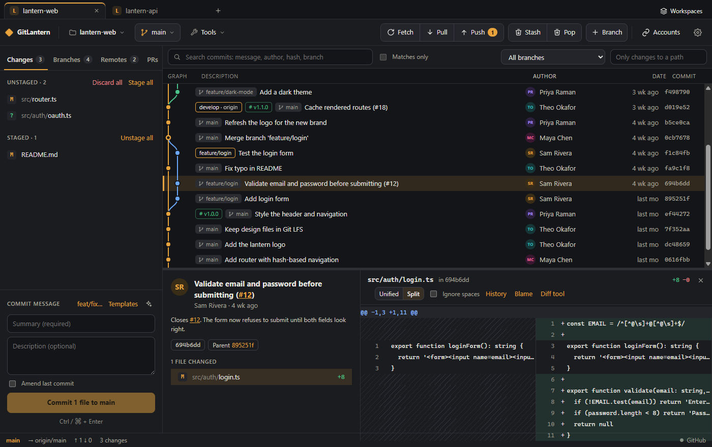

> **Status: early preview.** Tested on Windows 11. The macOS and Linux builds are experimental.

---

## Features

### Your history

- **Commit graph:** every branch, merge and tag as a coloured lane graph, with author avatars. It
  shows the latest 2,000 commits across all branches and scrolls smoothly through them. Uncommitted
  work appears as a dashed row on top.
- **Branch on every commit:** each commit is labelled with the branch it belongs to, even after that
  branch was merged and deleted (then the name comes from the merge commit and is shown in italics).
- **Search and filter:** search the history by message, author, hash or branch name, step through the
  matches with **Enter**, or show only the matches. Narrow the graph to one branch, or to the commits
  that changed a file or folder.
- **Commit details and diffs:** click a commit to see its message, author, parents, signature and
  changed files with line counts. Issue numbers in messages (#12 on GitHub, GitLab, Gitea and
  Bitbucket, or your own rules for Jira and the like) are links.
- **Unified or side by side:** read a diff in one column or old and new next to each other, and hide
  changes that only touch spaces. **Diff tool** opens the file in your own diff tool.
- **Images:** a changed image shows its old and new versions next to each other, with a slider to
  swipe between them, or faded over each other.
- **Compare anything:** **Ctrl-click** (**⌘-click**) a second commit to see everything between the two,
  or right-click a branch and **Compare with** the one you're on.
- **File history and blame:** every commit that changed a file, followed across renames, with its diff;
  and who last changed each line, with recent changes picked out.
- **Command log:** every git command GitLantern ran, as you'd type it in a terminal, with how long it
  took and how it ended.

### Committing

- **Stage and commit:** stage or unstage single files or everything at once, see each file's diff, and
  write a summary plus an optional description.
- **Lines and hunks:** stage, unstage or discard a single hunk with the buttons on it, or pick lines by
  clicking their line numbers (Shift-click for a range).
- **Amend:** add staged changes to the last commit, or just fix its message.
- **Help with the message:** templates (your own, or Git's `commit.template`), a Conventional Commits
  helper (`feat(auth): …`), and an **AI** button that writes the message from the staged changes, with
  Claude or any OpenAI-compatible service, Ollama included. Nothing is sent until you click it.
- **Discard and clean up:** throw away a file's changes, or clean up untracked and ignored files. They
  go to the trash, so a slip can be undone. Right-click a new file to add it to `.gitignore`.
- **Stash:** put your uncommitted changes aside (new files included) with an optional note, and pop
  them back later. Look inside a stash, apply it, pop it or delete it.
- **Patches:** save a commit, or your uncommitted changes, as a patch file, and apply one.

### Changing history

- **Edit history:** right-click a commit and **Edit history from here** to reorder the commits after
  it, squash or fix them up into the one above, reword their messages, stop at one to amend it, or drop
  it. Shortcuts for the common ones: **Edit commit message**, **Squash into parent** and **Drop commit**.
- **Revert and reset:** undo a commit with a new one, or move your branch to any commit. Reset explains
  what soft, mixed and hard keep before it does anything.
- **Merge, rebase and cherry-pick:** right-click a branch or commit to merge it, rebase onto it or copy
  a commit onto your branch. A dialog first explains what will happen (fast-forward, merge commit, how
  many commits get replayed, and whether any were already pushed).
- **Conflicts:** when a merge, rebase, cherry-pick, revert or stash stops on conflicts, a banner shows
  how far it got. Each conflicted file opens with its two sides highlighted, named after the branches
  they come from. Pick one side, the other or both for each conflict, or one side for the whole file,
  or open your merge tool. Then finish, skip the commit or abort.
- **Bisect:** right-click the last commit that was good and GitLantern checks out the commits in
  between one by one; mark each good or bad until it names the commit that brought the bug in.

### Branches, tags and more

- **Branches:** switch, create, rename and delete branches, push one, delete it on its remote, and set
  the remote branch it tracks.
- **Tags:** tag a commit (annotated and signed if you like), push tags, and delete them here or on the
  remote.
- **Worktrees:** check out another branch in a second folder and open it in its own tab.
- **Submodules:** add, update, open and remove repositories kept inside yours.
- **Git LFS:** set it up, choose which files it stores, see them, pull and push them, and lock files.
- **git-flow:** start and finish features, releases and hotfixes. It uses the same settings as the
  git-flow command-line tools, so both work together.
- **Archive:** save any commit's files as a zip.

### Pull requests and reviews

- **Pull requests:** the PRs tab (MRs on GitLab) lists the open pull requests of the repository's
  service. Open one in the browser, check it out (pull requests from forks too), or open a new one from
  your branch.
- **Review mode:** open a pull request to review it inside GitLantern: its description and
  conversation, every file it changes with the comments already on them, and a **Viewed** tick for each
  file. Click a line number to comment, then finish with a comment, an approval or a request for
  changes. Works with GitHub, GitLab, Gitea / Forgejo, Bitbucket and Azure DevOps.

### Any Git service

- **Connect accounts:** GitHub (and GitHub Enterprise), GitLab (and self-managed GitLab), Bitbucket,
  Azure DevOps, Gitea / Forgejo / Codeberg, or any other HTTPS Git server. Paste an access token
  (GitLantern links straight to the right page to create one), and it's checked with the service and
  stored encrypted by your operating system's keychain.
- **Sign in with the browser:** GitHub, GitLab and Gitea / Forgejo servers with an OAuth application
  set up for GitLantern (see [Where your data lives](#where-your-data-lives)) can be connected by
  approving GitLantern in the browser instead of making a token. GitHub shows a short code to enter on
  github.com. Tokens that expire are renewed automatically.
- **No more password prompts:** once a server is connected, GitLantern answers Git's sign-in requests
  for it automatically, for clone, fetch, pull and push.
- **Clone from anywhere:** paste any HTTPS or SSH address, or browse and filter the repositories in your
  connected accounts and clone with one click. Progress is shown as it downloads.
- **Fetch, pull and push:** fetch all remotes (by hand, or every few minutes in the background), pull and
  push. The buttons show how many commits are waiting. Pull never makes a merge commit behind your back.
  When your branch and the remote have both moved on, it asks whether to merge or rebase. A refused push
  is explained in plain words. A new branch's upstream is set on its first push.
- **Force push after a rebase:** when the remote only has old copies of commits you've since rebased
  or amended, Push offers a force push. It's a lease: it goes ahead only while the remote branch is
  still where GitLantern last saw it, so someone else's new commits are never thrown away.
- **Remotes tab:** see each remote's service and how it signs in. Add, edit or remove remotes, test a
  connection before you save it, and switch a remote between HTTPS and SSH with one click (Azure
  DevOps' different SSH format included).
- **SSH keys:** see your public key, create one if you don't have one, copy it to paste into a service,
  and test that a server accepts it. PuTTY-format keys are detected and converted.
- **Other prompts:** when Git or SSH asks something else (a key passphrase, a new host), GitLantern asks
  in a dialog and can remember the answer, encrypted.

### Your way

- **Tabs and workspaces:** open several repositories at once, each in its own tab, reopened next time.
  Save a set of them as a workspace and open them all together.
- **Settings:** light, dark or system theme, an accent colour, your own colours and the interface size;
  your Git name, email and commit and tag signing, everywhere or per repository; automatic fetching;
  your editor, terminal, diff tool and merge tool.
- **Open it elsewhere:** open the repository or a file in VS Code, Cursor, Zed, Sublime Text, a JetBrains
  IDE and others, open a terminal there, or show it in Explorer or Finder.
- **Custom actions:** add your own commands to the Tools menu, or to the menus of commits, branches and
  files (`${REPO}`, `${SHA}`, `${BRANCH}` and `${FILE}` are filled in). GitLantern asks once before a new
  command first runs.
- **Updates:** on Windows and in the Linux AppImage, a new version downloads in the background and
  installs when you restart GitLantern. On a Mac, and with the Linux .deb, GitLantern tells you when
  there's a new version to download.
- **Private by design:** no GitLantern account, no telemetry. It only talks to the network when Git does,
  when you ask it to check a token, list your repositories or pull requests, or write a commit message
  with AI, and to look for a new version on GitHub. That check sends nothing about you or your
  repositories.

<table>
  <tr>
    <td>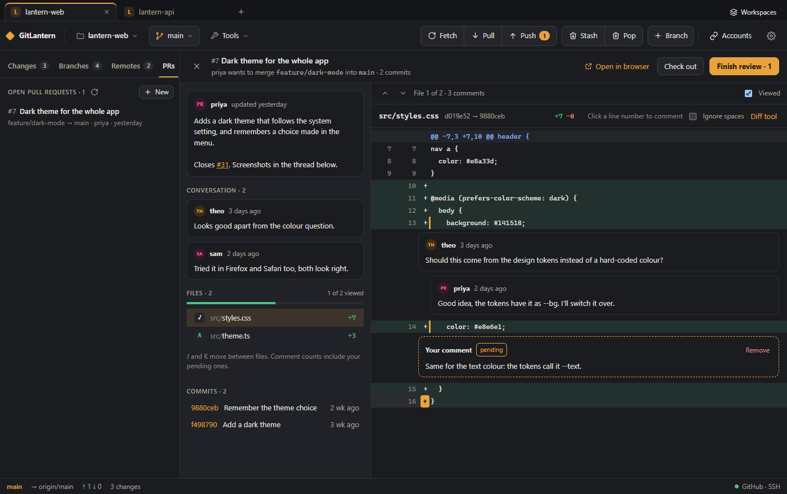</td>
    <td>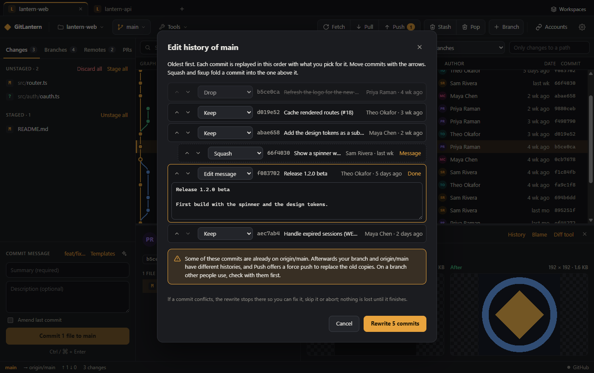</td>
  </tr>
  <tr>
    <td align="center">Review pull requests, with comments on lines</td>
    <td align="center">Reorder, squash, reword and drop commits</td>
  </tr>
  <tr>
    <td>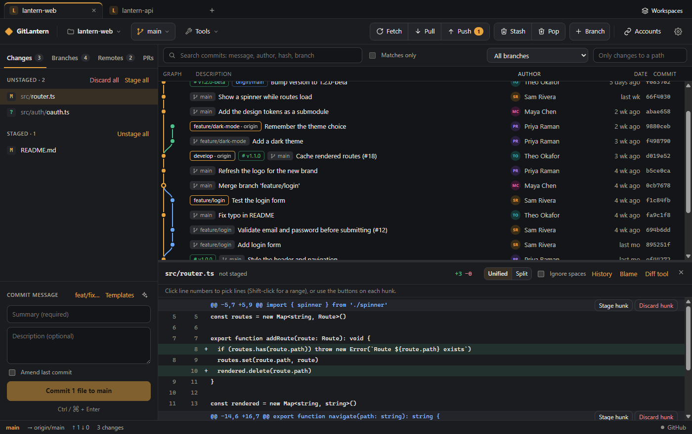</td>
    <td>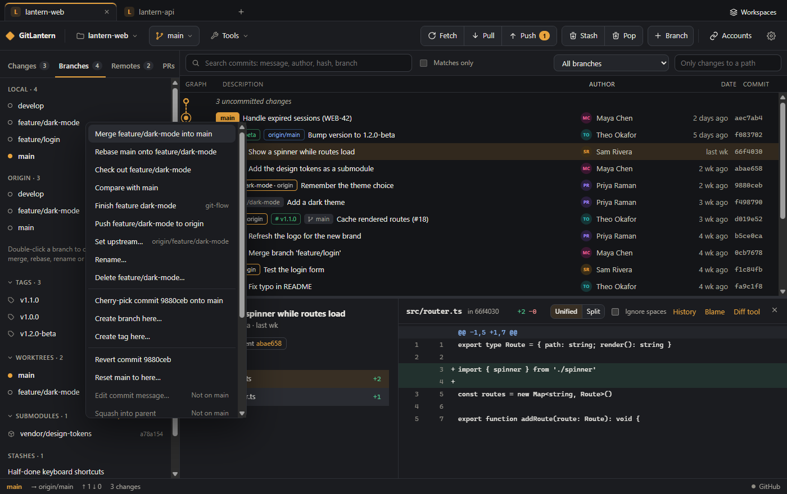</td>
  </tr>
  <tr>
    <td align="center">Stage lines and hunks, amend, write messages with AI</td>
    <td align="center">Branches, tags, worktrees, submodules and stashes</td>
  </tr>
  <tr>
    <td>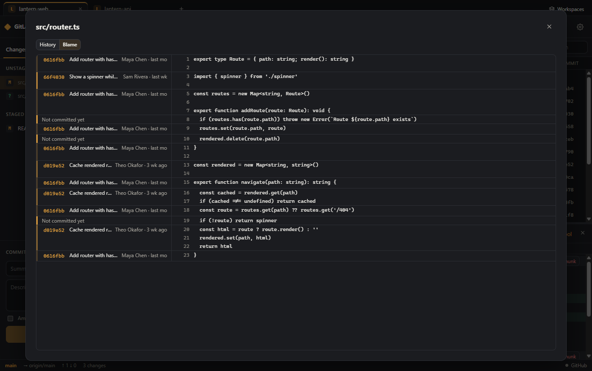</td>
    <td>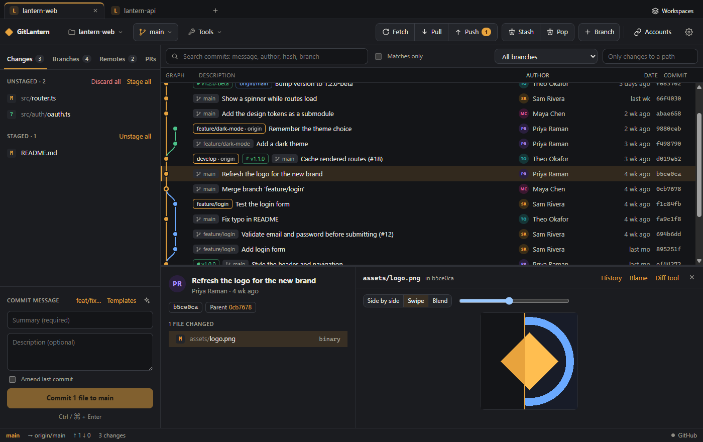</td>
  </tr>
  <tr>
    <td align="center">Blame and file history</td>
    <td align="center">Image diffs: side by side, swipe and blend</td>
  </tr>
  <tr>
    <td>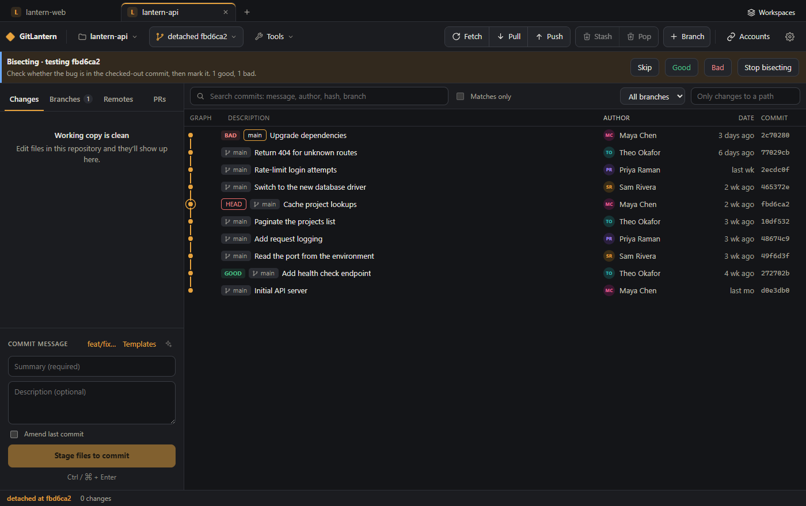</td>
    <td>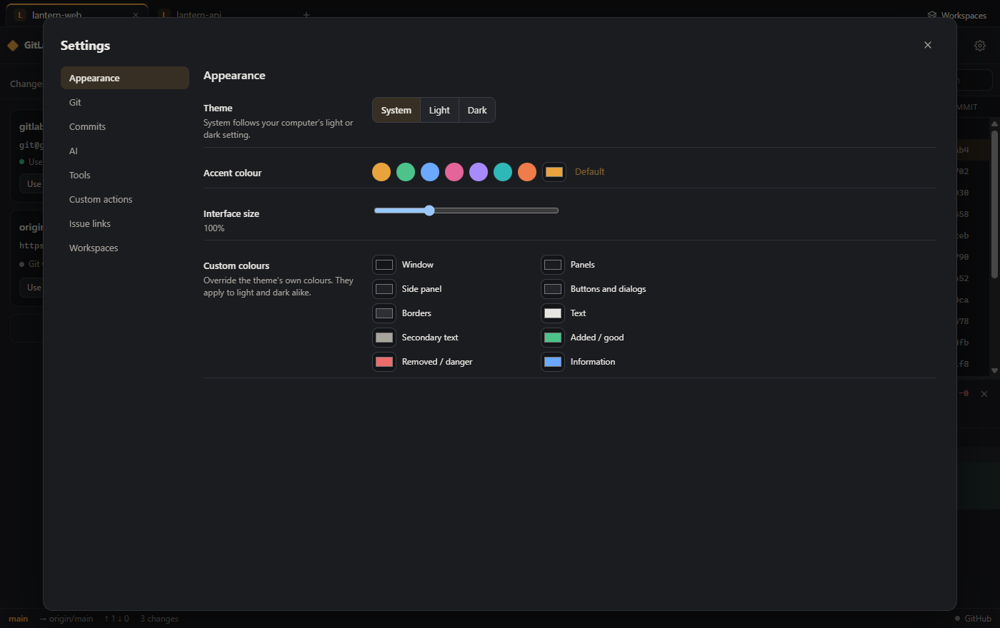</td>
  </tr>
  <tr>
    <td align="center">Find the commit that broke it, with bisect</td>
    <td align="center">Themes, colours and everything else in Settings</td>
  </tr>
  <tr>
    <td>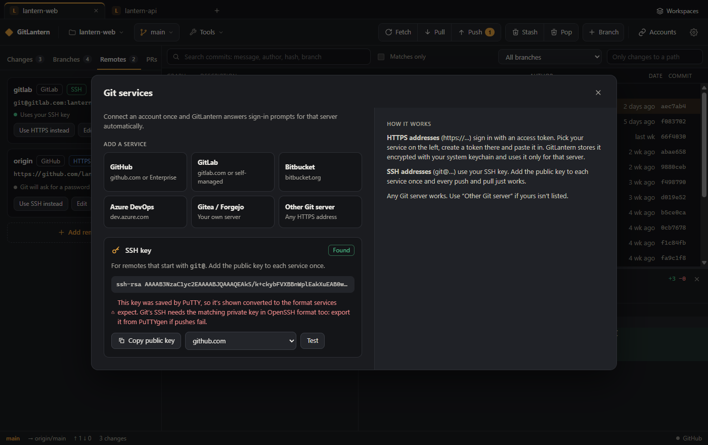</td>
    <td>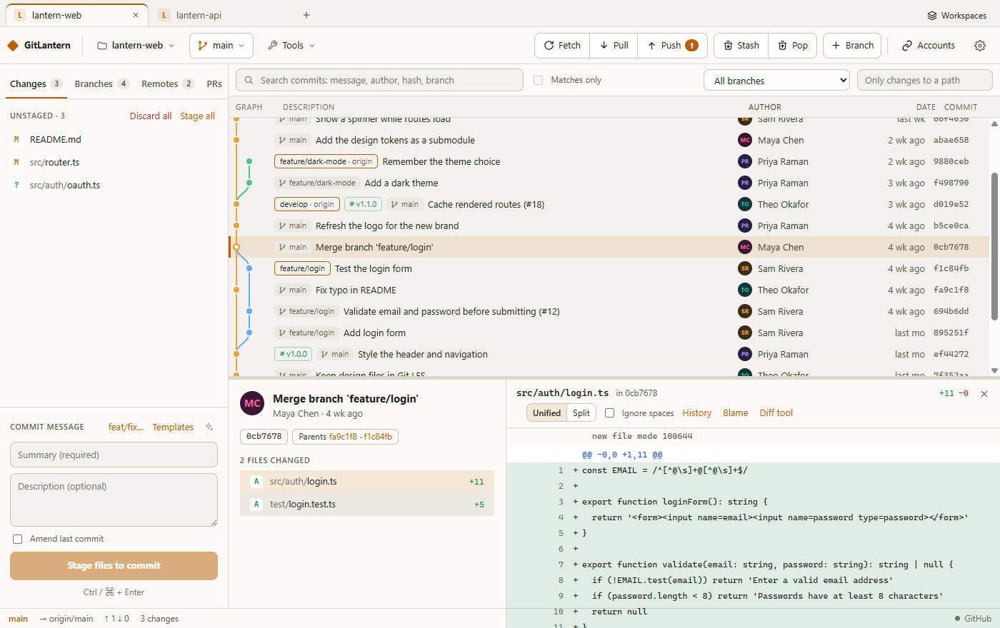</td>
  </tr>
  <tr>
    <td align="center">Connect GitHub, GitLab, Bitbucket, Azure DevOps, Gitea or any server</td>
    <td align="center">Light and dark themes</td>
  </tr>
</table>

More screenshots are in [docs/screenshots](docs/screenshots).

---

## Install

### 1. Install Git (if you don't have it)

GitLantern uses your computer's own Git. To check whether it's installed, open a terminal and run
`git --version`.

- **Windows:** install [Git for Windows](https://git-scm.com/download/win) with the default options.
- **macOS:** run `xcode-select --install` in Terminal, or `brew install git` if you use
  [Homebrew](https://brew.sh).
- **Linux:** install it with your package manager, for example `sudo apt install git` or
  `sudo dnf install git`. Add `git-lfs` too if you use Git LFS.

### 2. Download GitLantern

Get the latest installer from the [**Releases**](../../releases/latest) page:

| System | File | How to install |
|---|---|---|
| Windows 10 / 11 (64-bit) | `GitLantern-Setup-<version>.exe` | Run it and follow the steps. |
| macOS, Apple silicon (M1 and later) | `GitLantern-<version>-arm64.dmg` | Open it and drag **GitLantern** into **Applications**. |
| macOS, Intel | `GitLantern-<version>-x64.dmg` | Same as above. |
| Linux (64-bit), any distribution | `GitLantern-<version>-x86_64.AppImage` | Make it executable (`chmod +x`) and run it. It updates itself. |
| Debian, Ubuntu and similar | `gitlantern_<version>_amd64.deb` | `sudo apt install ./gitlantern_<version>_amd64.deb` |

**Coming from Git Steve?** GitLantern is the same app under a new name. It installs next to Git Steve
rather than replacing it, so uninstall Git Steve afterwards. Your recent repositories and settings come
across on the first start. Connected accounts don't (their tokens were encrypted for the old app), so
connect them again under **Accounts**.

**"Unknown publisher" warnings.** Preview builds aren't code-signed yet, so your system may warn you the
first time you open the app:

- **Windows (SmartScreen):** click **More info** → **Run anyway**.
- **macOS (Gatekeeper):** open GitLantern once and click **Done** when macOS says it can't verify it. Then
  go to **System Settings → Privacy & Security** and click **Open Anyway**. (On macOS 14 and earlier,
  right-clicking the app and choosing **Open** also works.)

### Or build it yourself

You need [Node.js](https://nodejs.org) 22.12 or newer, [Yarn 1](https://classic.yarnpkg.com)
(`npm install -g yarn`) and Git.

```bash
git clone https://github.com/SteveDeveloperConcepts/GitLantern.git
cd GitLantern
yarn install
yarn dev             # run the app in development mode
yarn dist:win        # or: yarn dist:mac (on a Mac), yarn dist:linux (on Linux) to build installers into dist/
```

Builds for the Microsoft Store and the Mac App Store are covered in [docs/RELEASING.md](docs/RELEASING.md).

---

## Using GitLantern

1. **Connect your Git service (optional, recommended):** click **Accounts** in the top bar (or
   **Connect a Git service** on the start screen) and pick your service. Click the link to its token
   page, create a token with the permissions shown, paste it in and click **Connect**. Using SSH
   instead? The same dialog shows your SSH key, creates one if you need it and tests it.
2. **Open or clone a repository:** **Open a repository…** picks a folder already on your computer.
   **Clone a repository…** takes any address, or lets you pick from your connected accounts. Folders
   you've opened before appear under **Recent** and in the repository menu at the top left. Each
   repository opens in a tab; **+** in the tab bar opens another, and **Workspaces** opens a saved set.
3. **Explore history:** scroll the graph, and click a commit to see its details and diff in the pane
   below. Use **↑ / ↓** to move between commits. Drag the divider to resize the pane. **Ctrl-click**
   (**⌘-click**) a second commit to compare the two. **History** and **Blame** above a diff show the
   file's past.
4. **Commit:** on the **Changes** tab, click a file to see its diff, then press **+** to stage it (or
   **Stage all**). To stage only part of a file, use **Stage hunk** in its diff, or click line numbers
   to pick lines and then **Stage**. The curved arrow next to a file discards its changes. Write a
   summary and click **Commit**, or press **Ctrl+Enter** (**⌘+Enter** on Mac). Tick **Amend last
   commit** to add to the last commit instead. The sparkle button writes the message with AI (set it up
   under **Settings → AI**). **Stash** in the top bar puts everything aside for later; **Pop** brings the
   latest stash back.
5. **Branches:** use the branch menu in the top bar, or the **Branches** tab: click a branch to jump to
   it in the graph, double-click to check it out. **Branch** creates one from where you are.
   **Right-click** a branch label or commit in the graph (or a branch on the Branches tab) to merge,
   rebase, cherry-pick, check out, rename, delete or compare it, tag a commit, revert it, reset to it,
   or edit the history from it. Tags, worktrees and submodules are on the Branches tab too.
   **Ctrl+F** (**⌘+F**) jumps to the search box above the graph.
6. **Remotes:** the **Remotes** tab lists where this repository pushes and pulls. **Add remote**
   connects a new or empty repository to a service. **Test connection** checks the address first.
7. **Sync:** use **Fetch**, **Pull** and **Push** in the top bar. The status bar at the bottom shows
   your branch, how many commits you're ahead or behind, and which account the remote uses. If Pull and
   Push both show a number, the remote has commits you don't and you have commits it doesn't. Click
   **Pull** and choose **Merge** or **Rebase** before you push.
8. **Pull requests:** the **PRs** tab lists the open pull requests on the repository's service once
   its account is connected. **Review** (or a double-click) opens one in review mode: pick a file, click
   a line number to comment, tick **Viewed** as you go (**J** and **K** move between files), then
   **Finish review** to comment, approve or request changes. **Check out** switches to its branch.
   **New** opens one from your branch: push the branch first, then pick the branch to merge into.
9. **Tools:** the **Tools** menu opens the repository in your editor or a terminal, and has git-flow,
   Git LFS, worktrees, submodules, patches, archives, cleaning up, your custom actions and the command
   log. The gear opens **Settings**.

## Where your data lives

GitLantern never changes anything in your repositories except through the Git commands you ask for. Its
own settings live here:

| System | Folder |
|---|---|
| Windows | `%APPDATA%\GitLantern` |
| Windows, installed from the Microsoft Store | `%LOCALAPPDATA%\Packages\<package name>\LocalCache\Roaming\GitLantern` |
| macOS | `~/Library/Application Support/GitLantern` |
| Linux | `~/.config/GitLantern` |

- `settings.json`: your recent repositories and open tabs, the last clone folder, an optional `gitPath`
  that points at a specific `git` executable, optional `oauthClients` (see below), and everything you
  set in **Settings** (theme, tools, custom actions, issue links, templates, workspaces).
- `accounts.json`: which services you've connected (server, username). It never contains tokens.
- `secrets.json`: account tokens (and the refresh tokens of browser sign-ins), your AI API key and
  answers you chose to remember, encrypted with Windows DPAPI, the macOS Keychain or the Linux keyring
  (GNOME Keyring or KWallet; without one, nothing is saved). They can't be read on another computer
  or by another user. Remove an account under **Accounts** and the AI key under **Settings → AI**. To
  clear remembered answers, open the **Branches** tab and click **Forget all**.

Your Git name, email and signing settings are Git's own (`git config`): **Settings → Git** changes them
in your global config or the repository's. Pending review comments and the files you marked viewed are
kept in the app until you submit the review.

**Setting up browser sign-in.** Browser sign-in needs an OAuth application on the server, and its
client ID (which isn't secret) in `settings.json`, for example
`"oauthClients": { "gitlab.example.com": "<client ID>" }`. Restart GitLantern after adding one.

- **GitHub** (or GitHub Enterprise): **Settings → Developer settings → OAuth Apps → New OAuth App**.
  Any homepage and callback URL will do; tick **Enable Device Flow**.
- **GitLab:** **User settings → Applications**. Untick **Confidential**, set the redirect URI to
  `http://127.0.0.1/callback` and tick the scopes `api`, `read_repository` and `write_repository`.
- **Gitea / Forgejo:** **Settings → Applications → Create a new OAuth2 application**. Untick
  **Confidential client** and set the redirect URI to `http://127.0.0.1/callback`.

GitLantern never changes your SSH keys. The only exception is **Create an SSH key**, which writes
`~/.ssh/id_ed25519` when you have no key yet.

To uninstall, remove the app as usual (Windows: **Settings → Apps**; macOS: drag it to the Trash).
Then delete the folder above if you also want your settings gone.

## Troubleshooting

**"Open in editor" or "Open a terminal" says nothing was found**<br>
GitLantern looks for editors and terminals in their usual install folders and on your `PATH`. Pick
one under **Settings → Tools**; if yours isn't listed, add it as a custom action instead.

**Diff tool or merge tool: "no tool is set up"**<br>
Name one under **Settings → Tools** (for example `vscode`, `meld` or `bc`), or set Git's own
`diff.tool` / `merge.tool`.

**The AI button says the key was rejected**<br>
Check the key under **Settings → AI**, and that the model name is right for that service. For Ollama
and other local servers, the address must end in `/v1` and no key is needed.

**Edit history stops halfway**<br>
A commit conflicted while it was replayed. Fix the conflicts on the **Changes** tab and click
**Continue**, **Skip commit** to leave that one out, or **Abort** to go back to how it was before.

**"Git was not found"**<br>
Install Git (see above) and restart GitLantern. If Git is somewhere unusual, pick it under
**Settings → Git → Git program → Choose…** (or add `"gitPath": "C:\\path\\to\\git.exe"` to
`settings.json`), then restart.

**I saved a wrong password**<br>
Go to **Branches → Forget all**, then retry. GitLantern will ask again.

**"The service rejected this token"**<br>
The token was copied incompletely or has expired. Create a new one from the link in the **Accounts**
dialog and connect again: it replaces the old one.

**Push fails with "Authentication failed" on a connected server**<br>
The token is missing a permission (the dialog lists the ones each service needs) or was revoked.
Reconnect the account with a fresh token.

**SSH: "didn't accept your SSH key"**<br>
Copy your public key from **Accounts → SSH key** and add it to your account's SSH key settings on that
service, then click **Test** again.

**I never see a password prompt for a server I haven't connected**<br>
Your Git credential manager (for example Git Credential Manager on Windows, or the macOS Keychain
helper) is handling sign-in, so you should see its window instead. Servers you connect in GitLantern use
your GitLantern account instead.

**"Push refused: origin/main has commits that main doesn't"**<br>
Someone else, or you on another computer, pushed to that branch since you last pulled. Click **Pull**.
Because both sides have new commits, GitLantern asks how to combine them. **Merge** adds a merge commit.
**Rebase** moves your commits after theirs. If the same lines changed on both sides, fix the conflicts
it shows, then push again. **Don't force-push here:** it would delete their commits from the server.

**"Replace origin/main?" when you push**<br>
You rebased, or amended, commits that were already pushed, so the server's copies have to be replaced
with a force push. GitLantern only offers it when every commit on the server was once on your branch,
and the push is refused if anyone pushed in the meantime. If other people use that branch, tell them
first: they'll need to reset their copies.

**"Force push refused: someone pushed to origin/main since you looked"**<br>
Someone pushed between GitLantern's check and your click. Click **Pull** to bring their commits in,
then push again.

**No "Sign in with … in your browser" button**<br>
Browser sign-in needs an OAuth application for that server. Paste a token instead, or set one up as
described under [Where your data lives](#where-your-data-lives).

**"Git couldn't apply those lines"**<br>
The file changed after its diff was shown, or the lines picked can't be separated (for example a
change to the last line of a file without a final newline). Pick the whole hunk instead.

## Roadmap

- Translations of the interface
- Signed installers and a bundled Git for Windows
- Statistics: who committed what, and when

Ideas and bug reports are welcome on the [Issues](../../issues) page.

## Contributing

GitLantern is built with Electron, React and TypeScript. [docs/DEVELOPMENT.md](docs/DEVELOPMENT.md) covers
how the code is organised and how to run it. Before opening a pull request, please run:

```bash
yarn typecheck
yarn build
yarn test
```

## License

GitLantern is released under the [MIT License](LICENSE). Copyright © 2026 Steve Vaubell.
